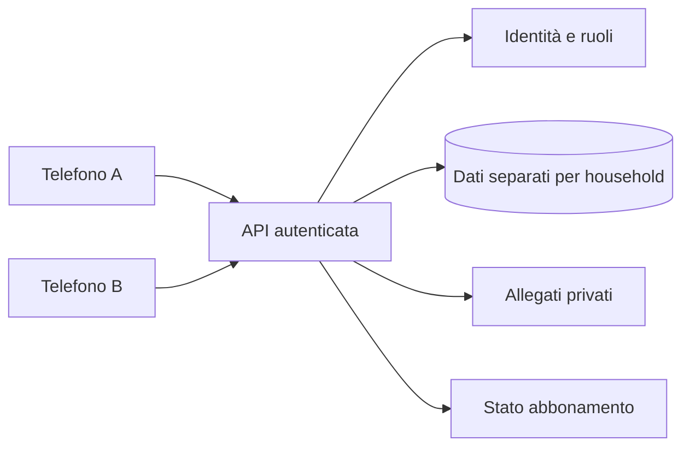

# ADR-001 — Oiko Family: identità, accessi e sincronizzazione

**Data:** 26 ottobre 2026  
**Stato:** DECISIONE PROGETTUALE — non implementata nella PWA attuale

## Contesto verificato
La PWA Oiko attuale è statica su GitHub Pages e salva spese, bollette, allegati e preferenze nel database IndexedDB locale `oiko-local-v1` (versione 1). Il backup `oiko-backup` è JSON v1. Non ci sono account o sincronizzazione. GitHub Pages non è il backend di un servizio Family.

## Decisione
- **Solo** continua a funzionare offline e senza account, con dati locali e backup manuali.
- **Family** userà *due identità personali*, una famiglia condivisa e backend sicuro con accessi controllati lato server.
- Accesso preferito: **passkey WebAuthn** dove supportate; fallback con credenziali robuste, recupero e verifica dell'account.
- **PIN personale di 6 cifre** o biometria è solo sblocco rapido su un dispositivo già autenticato, mai credenziale condivisa o finta barriera davanti a dati IndexedDB non cifrati.
- Proprietario e co-gestore possono entrambi registrare spese, gestire budget e scadenze, confermare pagamenti. Solo il proprietario gestisce fatturazione e azioni distruttive sul nucleo.
- Attribuire `created_by` (chi registra), `paid_by` (chi paga) e `assigned_to` (responsabile della scadenza); sono informazioni diverse.
- Nessuna credenziale privilegiata o segreto nel frontend/repository pubblico.

## Modello dati futuro
`users`, `households`, `memberships`, `expenses`, `bills`, `bill_occurrences`, `budgets`, `attachments`, `activity_events`, `subscriptions`.

Ogni dato condiviso ha `household_id`; ACL server-side, isolamento tenant, file privati, backup cifrati, TLS, sessioni a scadenza, rate limiting e log minimizzati. Gli importi restano in centesimi interi. L'operazione **Segna come pagata** deve essere atomica e idempotente per `bill_id` + data occorrenza: due tap da due telefoni non devono creare due spese.

## Flusso dati

La PWA può mantenere una cache locale offline; mostra *Da sincronizzare* finché il server non conferma. Conflitti gestiti mediante versioni e feedback visibile, senza sovrascritture silenziose.

## Migrazione
1. Backup JSON locale e anteprima non distruttiva.
2. Creazione account e nucleo Family.
3. Consenso esplicito all'importazione cloud con riepilogo di record e allegati.
4. Import atomico e deduplicazione; verifiche totali su due telefoni.
5. Conservare l'archivio originale finché la sincronizzazione non è stata validata.

**Attenzione:** un cambio di origine/dominio non trasferisce automaticamente IndexedDB.

## Criteri di accettazione
- Due account con credenziali distinte vedono gli stessi dati e i corretti autori/pagatori.
- Revoca membro blocca accessi nuovi; gestisce le sessioni attive.
- Due pagamenti concorrenti della stessa scadenza danno una sola registrazione.
- Test contro accesso ai dati di altre famiglie, modifica fraudolenta degli ID, recupero account, offline/retry.
- Le funzioni di pagamento, backup, import e cancellazione sono coperte da audit e da procedure documentate.
- Privacy policy, DPA, security review, supporto e meccanismi di esportazione/cancellazione precedono l'apertura commerciale.

## Non implementare
- PIN HTML/cookie/localStorage mostrato come sistema sicuro di autenticazione.
- PIN condiviso per due utenti.
- Database cloud o documenti privati nel repository pubblico.
- Servizio a pagamento senza revisione di contratti, privacy e sicurezza.

Riferimenti: [GDPR](https://eur-lex.europa.eu/eli/reg/2016/679/oj/ita) · [OWASP MFA](https://cheatsheetseries.owasp.org/cheatsheets/Multifactor_Authentication_Cheat_Sheet.html) · [OWASP Passkey](https://github.com/OWASP/CheatSheetSeries/blob/master/cheatsheets/Passkey_Security_Cheat_Sheet.md).
